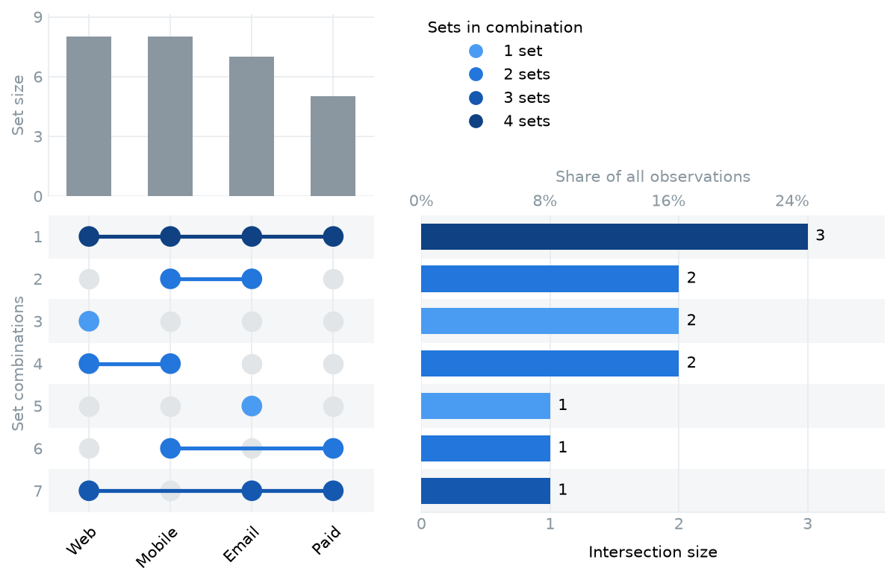
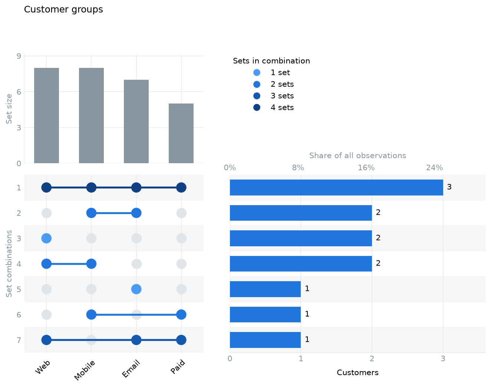
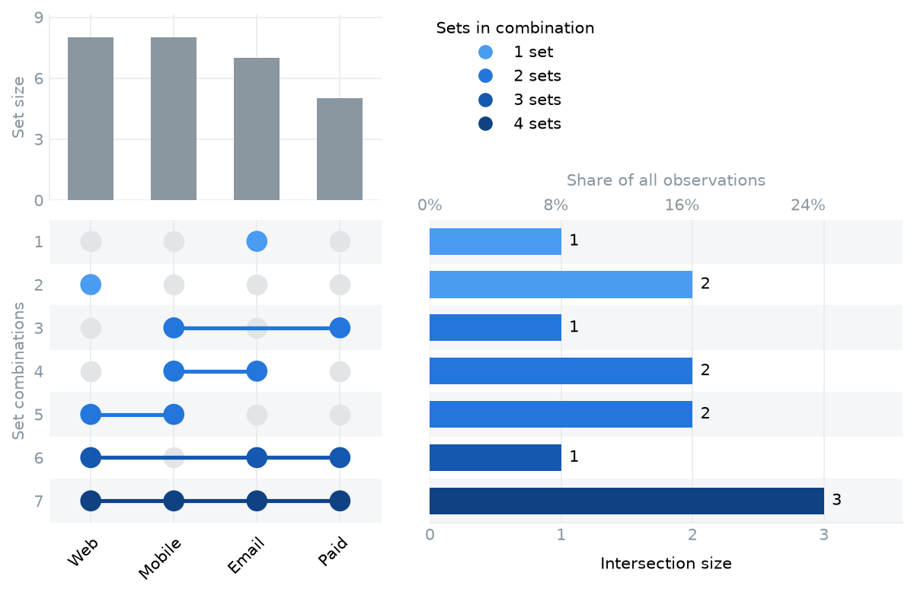

# ИНСТРУКЦИЯ ПОЛЬЗОВАТЕЛЯ PyUpSet (пошаговое руководство)

## 0. ВВЕДЕНИЕ

- **Название проекта:** PyUpSet — «Пересечения ваших данных — на одном графике».
- **Исходный код и установка:** [github.com/Up1ng/pyupset](https://github.com/Up1ng/pyupset).
- **Готовый пример:** [Jupyter Notebook](../examples/quickstart.ipynb). На GitHub можно посмотреть код; чтобы выполнить его, скачайте ноутбук и откройте в Jupyter.
- **Для кого этот продукт:** для аналитиков, исследователей, биоинформатиков и всех, кто сравнивает несколько групп объектов в pandas.
- **Что он делает:** показывает размеры групп, их точные пересечения и долю каждого сочетания среди всех наблюдений.
- **Сколько времени займёт знакомство:** около 5 минут до первого графика, если Python уже установлен; первая установка может занять дольше.

PyUpSet работает на вашем компьютере в Python или Jupyter. Регистрация, сервер и хостинг не нужны.



---

## 1. ПЕРВЫЙ ЗАПУСК

**Что понадобится:** компьютер с Python 3.10 или новее и Git для установки по ссылке ниже.

1. Откройте терминал и создайте папку для работы:

   ```bash
   mkdir pyupset-demo
   cd pyupset-demo
   python3 -m venv .venv
   ```

2. Активируйте окружение. На macOS и Linux:

   ```bash
   source .venv/bin/activate
   ```

   На Windows в командной строке (`cmd`):

   ```bat
   .venv\Scripts\activate.bat
   ```

   Если в Windows команда `python3` не найдена, используйте `py` вместо неё.

3. Установите библиотеку:

   ```bash
   python -m pip install "git+https://github.com/Up1ng/pyupset.git@v0.1.0"
   ```

4. Создайте файл `first_plot.py` и скопируйте в него пример из следующего раздела.
5. Запустите файл:

   ```bash
   python first_plot.py
   ```

**Что вы увидите:** окно с графиком пересечений четырёх групп клиентов. Если работаете без графического интерфейса, сохраните график в файл по инструкции из раздела 3 вместо `plt.show()`.

**Если вы работаете в Jupyter:** выберите ядро, в котором установлен PyUpSet, вставьте Python-код в ячейку и нажмите **Shift + Enter**. Для запуска Jupyter из созданного окружения:

```bash
python -m pip install jupyterlab
python -m jupyter lab
```

> Во время установки нужен интернет. После установки библиотека строит графики локально и не отправляет ваши таблицы на сервер.

---

## 2. ОСНОВНАЯ ФУНКЦИЯ №1: ГРАФИК ПРЯМО ИЗ ТАБЛИЦЫ

**Название функции:** построение UpSet-диаграммы из pandas DataFrame.

**Зачем она нужна:** чтобы понять, какие группы пересекаются и сколько объектов относится к каждому сочетанию. Например, кто из клиентов пользуется сайтом, мобильным приложением, рассылкой и платной подпиской.

**Пошаговая инструкция:**

1. Подготовьте таблицу: одна строка — один клиент, один столбец — одна группа.
2. Отметьте принадлежность к группе числом `1`, отсутствие — числом `0`. Можно использовать `True` и `False`.
3. Передайте таблицу в `pyupset.plot(...)`.
4. В `sets` перечислите нужные столбцы в том порядке, в котором хотите видеть их на графике.
5. Вызовите `plt.show()`, чтобы открыть график.

**Готовый пример для `first_plot.py`:**

```python
import pandas as pd
import matplotlib.pyplot as plt
import pyupset

customers = pd.DataFrame({
    "Web":    [1, 1, 1, 0, 0, 1, 1, 0, 1, 1, 0, 1],
    "Mobile": [0, 1, 1, 1, 0, 0, 1, 1, 1, 0, 1, 1],
    "Email":  [0, 0, 1, 0, 1, 0, 1, 1, 0, 1, 1, 1],
    "Paid":   [0, 0, 1, 1, 0, 0, 1, 0, 0, 1, 0, 1],
})

fig, axes = pyupset.plot(
    customers,
    sets=["Web", "Mobile", "Email", "Paid"],
    sort_by="size",
)
plt.show()
```

**Пример результата:** на графике будет 7 сочетаний для 12 клиентов. Трое клиентов входят во все четыре группы, двое пользуются только сайтом.

**Как читать график:**

| Часть графика | Что она показывает |
| --- | --- |
| Столбцы сверху слева | Размер каждой группы: Web — 8, Mobile — 8, Email — 7, Paid — 5 |
| Матрица снизу слева | Каждая строка — одно точное сочетание групп |
| Синие точки и соединяющая линия | В какие группы входят объекты этого сочетания |
| Светло-серые точки | В какие группы они не входят |
| Горизонтальный столбец справа | Число объектов с этим сочетанием |
| Шкала процентов над столбцами | Доля сочетания среди всех строк таблицы |
| Цвет и легенда | Сколько групп участвует в сочетании |

Например, синие точки только под **Web** и **Mobile** означают клиентов, которые входят в эти две группы и не входят в **Email** и **Paid**. Это отдельное сочетание от клиентов, которые входят во все четыре группы.

**Если данные уже в CSV:** загрузите таблицу через `pd.read_csv("customers.csv")` вместо создания DataFrame вручную. Выбранные столбцы должны содержать `0/1` или `True/False` без пропусков; столбцы с именами и другими данными не включайте в `sets`.

---

## 3. ОСНОВНАЯ ФУНКЦИЯ №2: НАСТРОЙКА И СОХРАНЕНИЕ ГРАФИКА

**Название функции:** настройка через matplotlib и экспорт в PNG или PDF.

**Зачем она нужна:** чтобы использовать график в презентации, отчёте или статье и подобрать оформление под свою задачу.

**Пошаговая инструкция:**

1. После создания таблицы `customers` из раздела 2 постройте график с нужными цветами и размером.
2. Через `axes` измените подпись нужной панели.
3. Сохраните результат командой `fig.savefig(...)`.
4. Откройте файл из рабочей папки.

```python
custom_fig, custom_axes = pyupset.plot(
    customers,
    sets=["Web", "Mobile", "Email", "Paid"],
    sort_by="size",
    colors={"intersections": "#2276dc", "sets": "#8a97a0"},
    figsize=(10, 8),
)
custom_axes["intersections"].set_xlabel("Customers")
custom_fig.suptitle("Customer groups", x=0.13, ha="left")

custom_fig.savefig("customer-overlap.png", dpi=300, bbox_inches="tight")
custom_fig.savefig("customer-overlap.pdf", bbox_inches="tight")
```

**Пример результата:** файлы `customer-overlap.png` и `customer-overlap.pdf` с вашим оформлением. PNG удобно вставлять в презентацию, PDF — использовать для печати и масштабирования.



**К каким частям графика можно обратиться:**

| Объект | Панель |
| --- | --- |
| `axes["matrix"]` | Матрица точек |
| `axes["intersections"]` | Мощности пересечений |
| `axes["sets"]` | Размеры отдельных групп |

Если хотите сохранить раскраску пересечений по числу групп, не задавайте `colors["intersections"]`. Библиотека подберёт цвета автоматически.

> Сохраняйте график перед `plt.show()` в обычном скрипте. После работы можно закрыть его командой `plt.close(fig)`.

---

## 4. ОСНОВНАЯ ФУНКЦИЯ №3: СОРТИРОВКА ПЕРЕСЕЧЕНИЙ

**Название функции:** выбор порядка сочетаний по числу объектов или числу участвующих групп.

**Зачем она нужна:** чтобы сначала увидеть самые крупные пересечения либо изучить сочетания от простых к сложным.

**Пошаговая инструкция:**

1. Используйте ту же таблицу `customers` из раздела 2.
2. Укажите `sort_by="size"`, чтобы самые частые сочетания оказались сверху.
3. Укажите `sort_by="degree"`, чтобы сочетания шли по возрастанию числа групп.
4. Сравните полученные графики.

```python
size_fig, size_axes = pyupset.plot(
    customers,
    sets=["Web", "Mobile", "Email", "Paid"],
    sort_by="size",
)

degree_fig, degree_axes = pyupset.plot(
    customers,
    sets=["Web", "Mobile", "Email", "Paid"],
    sort_by="degree",
)
plt.show()
```

**Пример результата:** при сортировке по мощности первым будет сочетание всех четырёх групп — 3 клиента. При сортировке по степени сначала будут сочетания из одной группы, затем из двух, трёх и четырёх.

| По мощности (`size`) | По степени (`degree`) |
| --- | --- |
|  |  |

Если не указать `sort_by`, применяется сортировка по степени.

---

## 5. ЧТО ДЕЛАТЬ, ЕСЛИ ЧТО-ТО ПОШЛО НЕ ТАК

Ошибки отображаются в терминале или под ячейкой Jupyter. Обычно достаточно проверить названия столбцов и значения в выбранных группах.

| Что вы видите | Что делать |
| --- | --- |
| `ModuleNotFoundError: No module named 'pyupset'` | Активируйте окружение из раздела 1 и повторите установку. В Jupyter выберите ядро этого окружения |
| При установке Git не найден | Установите Git и повторите команду либо скачайте `.whl` из [релиза](https://github.com/Up1ng/pyupset/releases/tag/v0.1.0) и выполните `python -m pip install имя_файла.whl` |
| `Set columns not found` | Проверьте имена в `sets`, включая регистр и пробелы. Посмотреть столбцы можно через `print(customers.columns.tolist())` |
| `contains missing values (NaN/NA)` | В выбранном столбце есть пропуски. Уточните их смысл и исправьте данные. Если пропуск означает отсутствие в группе, замените его на `False` |
| `must contain binary numeric 0/1 or boolean values` | Подготовьте столбцы принадлежности: `0/1` либо `True/False`. Текстовые ответы и числа вроде `2` не подходят |
| `sort_by must be 'degree' or 'size'` | Используйте ровно `"degree"` или `"size"` |
| `No data to plot` | Таблица пуста. Проверьте, не удалил ли фильтр все строки |
| Код выполнился, но окна нет | В скрипте добавьте `plt.show()`. При работе на сервере сохраните график через `fig.savefig(...)` |
| Сохранённый файл не удаётся найти | Он лежит в текущей рабочей папке. Посмотреть её можно через `print(Path.cwd())` после `from pathlib import Path`; при сохранении можно указать полный путь |

Если проблема осталась, [создайте issue](https://github.com/Up1ng/pyupset/issues/new/choose): опишите ожидаемый результат и приложите небольшой пример с вымышленными данными.

---

## 6. ЧАСТЫЕ ВОПРОСЫ (FAQ)

**Нужен ли хостинг или аккаунт?**

Нет. Установите библиотеку и запускайте её в Python или Jupyter на своём компьютере.

**Где хранятся мои данные?**

В памяти вашего Python-процесса. PyUpSet не отправляет таблицы на сервер и не изменяет исходный DataFrame. Файлы графиков появляются только по вашей команде сохранения.

**Нужен ли интернет?**

Для установки и скачивания примеров — да. Для построения графиков из локальных данных после установки — нет.

**Сколько групп можно сравнивать?**

Можно передать одну или несколько групп; диаграмма особенно полезна для четырёх и более. Чем больше различных сочетаний встречается в данных, тем длиннее график.

**Почему размеры групп в сумме больше числа клиентов?**

Один клиент может входить в несколько групп. Поэтому размеры отдельных групп перекрываются. Мощности точных сочетаний справа, напротив, в сумме дают число строк таблицы.

**Что означает строка, в которой все точки серые?**

Это объекты, которые не входят ни в одну выбранную группу. Они учитываются как отдельное сочетание с нулевой степенью.

**Что означает «степень»?**

Число групп в сочетании. Например, только Web — степень 1, Web и Mobile — степень 2, все четыре группы — степень 4.

**Почему одинаковые строки учитываются несколько раз?**

Каждая строка считается самостоятельным наблюдением. Если строки случайно дублируют одного человека, удалите такие дубликаты до построения графика.

**Можно автоматически выбрать столбцы?**

Да: `pyupset.plot(customers)` выберет бинарные числовые и булевы столбцы без пропусков. Если в таблице есть другие бинарные признаки, явно укажите нужные группы через `sets`.

**Как начать заново или построить график для другой таблицы?**

Вызовите `pyupset.plot(...)` с новыми данными. Каждый вызов независим. Чтобы закрыть все открытые графики, используйте `plt.close("all")`.

**Где посмотреть дополнительные настройки?**

В [полном руководстве](guide.md), [готовом скрипте](../examples/basic.py) и [Jupyter-примере](../examples/quickstart.ipynb).
