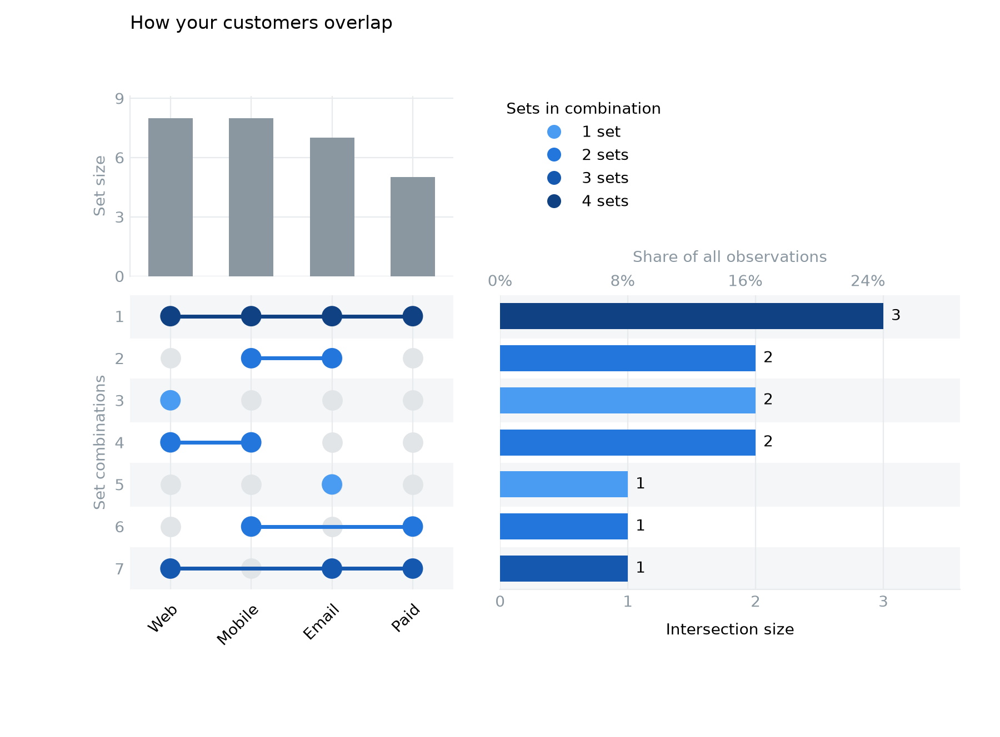

# Руководство PyUpSet

Python-библиотека для UpSet-диаграмм непосредственно из **pandas DataFrame**.
Результат — стандартные **matplotlib Figure и Axes**, пригодные для Jupyter,
дальнейшей настройки и сохранения в PNG/PDF. Все вычисления выполняются локально.

## Установка

Из каталога проекта (Python 3.10+):

```bash
python3 -m venv .venv
source .venv/bin/activate
python -m pip install -e '.[dev]'
```

Для ноутбуков: `python -m pip install -e '.[notebook]'`.
Установка опубликованной версии с GitHub: `pip install "git+https://github.com/Up1ng/pyupset.git@v0.1.0"`.

## Быстрый старт

```python
import pandas as pd
import pyupset

df = pd.DataFrame({
    'A': [True, True, False, True],
    'B': [False, True, True, True],
    'C': [False, True, False, True],
    'D': [False, False, True, True],
})

fig, axes = pyupset.plot(df, sets=['A', 'B', 'C', 'D'], sort_by='degree')
axes['intersections'].set_title('Мощности точных пересечений')
fig.savefig('upset.png', dpi=300, bbox_inches='tight')
fig.savefig('upset.pdf', bbox_inches='tight')
```

В Jupyter завершите ячейку выражением `fig`. В скрипте вызовите
`matplotlib.pyplot.show()` или сохраните Figure. После использования закройте
её через `matplotlib.pyplot.close(fig)`.



Готовый скрипт: [examples/basic.py](../examples/basic.py).
Ноутбук: [examples/quickstart.ipynb](../examples/quickstart.ipynb).

## API

```python
pyupset.plot(
    data: pd.DataFrame,
    sets: list[str] | None = None,
    sort_by: str = 'degree',
    **kwargs,
) -> tuple[matplotlib.figure.Figure, dict[str, matplotlib.axes.Axes]]
```

| Параметр | Поведение |
| --- | --- |
| `data` | DataFrame, одна строка — одно наблюдение |
| `sets` | Упорядоченный список уникальных имён столбцов; порядок сохраняется в матрице |
| `sets=None` | Автоматический выбор числовых/булевых бинарных столбцов без пропусков |
| `sort_by='degree'` | Возрастание количества участвующих множеств |
| `sort_by='size'` | Убывание мощности пересечения |
| `colors` | Один цвет matplotlib или словарь с ключами `matrix`, `intersections`, `sets` |
| `figsize` | Размер Figure в дюймах, по умолчанию автоматически по числу множеств и пересечений |
| `marker_size` | Площадь маркера matplotlib в pt², по умолчанию `150` |
| `line_width` | Толщина соединяющих линий, по умолчанию `2.5` |
| `wspace`, `hspace` | Отступы GridSpec, по умолчанию `0.12` / `0.08` |
| `font_size` | Размер подписей, по умолчанию `10` |

Словарь возвращаемых осей всегда содержит ровно `matrix`, `intersections`, `sets`.
Компоновка соответствует примеру лабораторной 2: **сверху слева** — размеры
множеств, **снизу слева** — матрица (множества по X, пересечения по Y),
**справа** — горизонтальные столбцы мощностей пересечений с подписями значений.
Матрица и размеры множеств имеют общую ось X, матрица и пересечения — Y.
Серые точки показывают отсутствие принадлежности, синие точки и линии — участие.
Цвет по умолчанию обозначает степень пересечения; легенда находится сверху справа.
Над мощностями пересечений есть дополнительная шкала процентов от всех строк.
`colors={'matrix': ..., 'intersections': ...}` заменяет цветовую шкалу заданными
цветами; `None` включает окрашивание по степени. Размер Figure подбирается
автоматически, его можно задать через `figsize`. Это изменение исходной раскладки
PDF внесено по указанию пользователя с опорой на пример из лабы.

```python
fig, axes = pyupset.plot(
    df, sets=['A', 'B', 'C', 'D'], sort_by='size',
    colors={'matrix': 'black', 'intersections': 'steelblue', 'sets': 'seagreen'},
    figsize=(12, 7), marker_size=60,
)
axes['intersections'].set_xlabel('Число наблюдений')
```

Стили matplotlib применяются через привычный `plt.style.context(...)`.
Глобальные rcParams не изменяются.

### Правила подсчёта

Подсчитываются **наблюдаемые точные (exclusive) комбинации** через
`df.groupby(sets).size()`. Например, `(A=True, B=True, C=False)` означает
«в A и B, вне C». Это отдельная группа от `(True, True, True)`.
Ненаблюдаемые комбинации с нулевой мощностью не добавляются.
Наблюдаемая комбинация «вне всех множеств» учитывается как степень 0:
для неё есть столбец мощности и пустая колонка матрицы.
Сумма мощностей пересечений равна числу входных строк.
Мощность множества учитывает все строки с True в его столбце.

Дубликаты строк считаются самостоятельными наблюдениями. Индекс DataFrame
не используется. При равенстве критерия сортировки применяется лексикографический
порядок бинарных комбинаций (False перед True) в порядке `sets`.

### Валидация и пустое состояние

Допускаются числовые `0/1`, `0.0/1.0`, `True/False`, pandas `boolean` и nullable
числовые типы без пропусков. Строки `'0'/'1'` и другие небинарные данные отклоняются.
Входной DataFrame не изменяется; невыбранные столбцы могут содержать любые данные.

| Ситуация | Результат |
| --- | --- |
| Отсутствующий столбец | `KeyError` с именами столбцов |
| NaN/NA, небинарные значения | `ValueError` с именем столбца |
| Пустой `sets`, повторные имена, неизвестная сортировка | `ValueError` |
| Неверный тип входа/списка, неизвестный параметр | `TypeError` |
| Нехватка памяти | `MemoryError` с исходным исключением в `__cause__` |
| Пустой DataFrame с явно указанными столбцами | Figure с текстом `No data to plot` и тремя скрытыми осями |

Вычисления синхронны, состояние и история не сохраняются. Нет сети, хранилища
и неявного экспорта: сохранять график решает вызывающий код через `fig.savefig`.

## Проверка и сборка

```bash
python -m pytest
python -m mypy src/pyupset
python -m black --check src tests examples/basic.py benchmarks
python -m build
python examples/basic.py
python benchmarks/benchmark.py
```

Бенчмарк по умолчанию использует 1 000 000 строк и 8 множеств (до 256 комбинаций).
Отдельно измеряет валидацию с вычислениями (цель ≤3 с) и построение графика вместе
с `canvas.draw()` (цель ≤5 с). Оценка зависит от CPU, числа множеств, количества
наблюдаемых комбинаций и памяти. При большом количестве множеств число комбинаций
может расти экспоненциально; PDF не задаёт предел числа множеств.
Данные не семплируются: мощности всегда точные.

## Архитектура и соответствие ТЗ

Описание компонентов, решений по неоднозначностям и таблица требований:
[docs/requirements.md](requirements.md).

## План развития

MVP реализует три функции: прямой ввод DataFrame, совместимый с matplotlib
вывод и сортировку по степени/мощности. Plotly, интерактивный HTML, интеграция
R/JS и небинарные столбцы отнесены PDF к этапу после MVP. Платная подписка,
продвижение и публикация на внешних площадках описаны как бизнес-гипотезы.

Лицензия: [MIT](../LICENSE).
