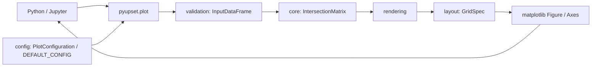

# Соответствие исходным PDF

Источники: `Upset plot архитектура.pdf` (6 страниц) и `Копия Upset plot.pdf`
(8 страниц). Реализован MVP Python-библиотеки, определённый техническим ТЗ;
бизнес-документ описывает её пользователей, распространение и последующие этапы.

## Компоненты

Данные идут через внутренние вызовы функций, DataFrame и numpy-массивы.
После валидации создаётся булева копия только выбранных столбцов.
`IntersectionMatrix` хранит порядок множеств, уникальные кортежи имён участвующих
множеств, бинарную матрицу, мощности пересечений и общие мощности множеств.
`PlotConfiguration` содержит настройки одного вызова. Исходный DataFrame
не сохраняется в Figure. Библиотека не вызывает `show`, не создаёт файлов и
не обращается к внешним сервисам.

## Проверяемые требования

| Источник | Требование | Реализация / проверка |
| --- | --- | --- |
| Архитектура, с. 1–2 | Python, pandas/numpy, локальный CPU, stateless | `src/pyupset`, зависимости в `pyproject.toml`, независимость вызовов в `tests/test_plot.py` |
| Архитектура, с. 3–4 | Валидация DataFrame и списка множеств | `validation.py`, `tests/test_core.py` |
| Архитектура, с. 4 | NaN и небинарные значения → ValueError | Строгая проверка без заполнения пропусков |
| Архитектура, с. 4 | Отсутствующий столбец → KeyError | Проверка всех имён до вычислений |
| Архитектура, с. 4 | Нехватка памяти → MemoryError | `api.py`, тест подмены вычисления |
| Архитектура, с. 4 | `groupby(sets).size()`, degree/size | `core.py`, независимая проверка через Counter |
| Архитектура, с. 4 | Figure и dict Axes с тремя ключами | `api.plot`, интеграционные тесты |
| Архитектура, с. 5 | DEFAULT_CONFIG в config.py | Цвета, маркеры, размеры, отступы, шрифт |
| Компоновка: уточнение пользователя по lab2 | Размеры множеств сверху, матрица снизу слева, мощности пересечений справа | `layout.py`, проверка положения и общих осей |
| Архитектура, с. 5 | Пустое состояние | `No data to plot` в центре Figure |
| Архитектура, с. 1 | 1 млн строк ≤2–3 с, рендер ≤5 с | `benchmarks/benchmark.py`, измерение вместе с canvas.draw |
| Архитектура, с. 5–6 | git, venv, pyproject, pytest/mypy/black | Окружение и инструменты разработки настроены |
| Архитектура, с. 6 | Unit/integration-тесты | `tests/test_core.py`, `tests/test_plot.py` |
| Архитектура, с. 6 | README и Jupyter-примеры | README, `examples/quickstart.ipynb`, `examples/basic.py` |
| Бизнес, с. 3 | Автоопределение столбцов | Дополнительный режим `sets=None` |
| Бизнес, с. 3–4 | Настройка Axes, PNG/PDF | Стандартные объекты matplotlib, пример и тест экспорта |
| Бизнес, с. 5 | Открытая лицензия | MIT |

## Решения по неоднозначностям

1. Технический контракт уточняет общий Figure/Axes из бизнес-документа:
   возвращается именно `(Figure, {'matrix': Axes, 'intersections': Axes, 'sets': Axes})`.
2. В техническом контракте `sets` обязателен; бизнес-документ обещает автоматическое
   определение. Явный вызов полностью поддержан; `sets=None` добавляет автопоиск.
   В этом режиме пропуски исключают столбец из кандидатов. Для строгой проверки
   требуемых столбцов следует указывать `sets` явно.
3. «Все возможные пересечения» уточнены сценарием из бизнес-документа и алгоритмом
   ТЗ: считаются все **наблюдаемые** точные комбинации, без генерации пустых групп.
4. Из двух допустимых вариантов обработки NaN выбран `ValueError`;
   из вариантов пустого состояния — Figure с заданным текстом.
5. Направления сортировки и разрешение равенств не определены PDF:
   degree возрастает, size убывает, равенства разрешаются бинарным порядком.
6. Меры снижения будущих рисков (sampling, импорт формата upsetplot, стилевые
   пресеты) не включены в три обязательные функции MVP. Sampling не применяется,
   чтобы не менять точные мощности пересечений.
7. Внешняя публикация (PyPI, GitHub, документация), маркетинг, платные планы,
   поиск пользователей и метрики спроса являются бизнес-этапами, а не локальным
   функциональным контрактом библиотеки. Пакет готов к сборке; публикация на GitHub выполнена отдельно по запросу пользователя.

## Уточнение визуального оформления

По последующему указанию пользователя исходная компоновка PDF заменена на
горизонтальную компоновку из `lab2/Solution_002`:
размеры множеств сверху слева, матрица снизу слева, мощности пересечений справа.
Добавлены серые неактивные точки, чередующиеся полосы, цвет по степени, легенда,
подписи мощностей и процентная шкала. Авторазмер Figure ограничен 24 дюймами
по каждой стороне. Порядок выбранных множеств и правила подсчёта сохранены,
включая наблюдаемую комбинацию вне всех множеств (степень 0, серый цвет).
В отличие от лабы, наблюдения вне всех множеств не отбрасываются.
